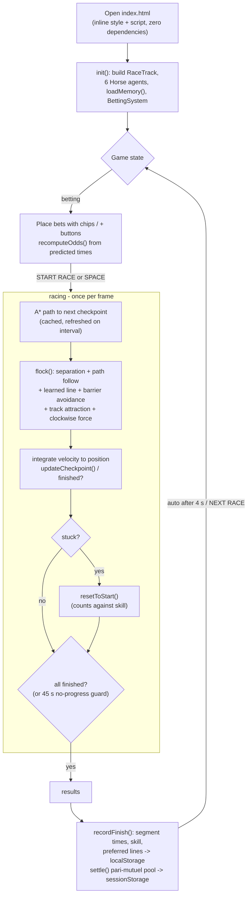

# Horse Race Derby

A single-file HTML game: six AI horses race a square, clockwise dirt circuit while you bet
fake money on the outcome. Each horse is an independent agent that plans routes with **A\*
pathfinding** and steers with **boids-style flocking forces** — and it *remembers* previous
races, so the field genuinely improves (and the odds shift) over time.

## The one file

Everything lives in [`index.html`](./index.html). No build step, no bundler, no npm install,
no CDN links, no external assets, no fonts, no images — the track, rails, fences, labels and
horses are all drawn procedurally on a `<canvas>` at runtime.

| What you'd expect elsewhere | Where it is now                                          |
| --------------------------- | -------------------------------------------------------- |
| `style.css`                 | Inline `<style>` block in the document `<head>`           |
| `app.js` / ES modules       | One inline `<script>` block wrapped in an IIFE            |
| Track & sprite PNGs         | Pre-rendered once into an offscreen canvas by `RaceTrack` |
| Backend / database          | Browser `localStorage` + `sessionStorage`                 |

Because the script is self-contained (not ES modules), it works when you simply
**double-click `index.html`** or drag it into a browser tab over `file://`. Serving it is
optional; if you prefer HTTP: `python3 -m http.server` then open `http://localhost:8000`.

## How to play

1. You start with a **$500 bankroll**. Pick a chip value ($10 / $25 / $50 / $100) and click a
   horse (or its **+** button) to place bets; click a bet row to remove it.
2. Press **START RACE** or hit **SPACE**.
3. Watch. First past the post wins; the pool is paid out **pari-mutuel** among winning tickets
   and your balance updates.
4. Repeat. Horses keep their learned racing lines and skill across sessions. Extras: press
   **R** mid-race to put the field back on the starting line, **Wipe All Horse Memory** to
   erase every horse's learning, **Reset Bankroll** to return to $500, and the *wipe memory on
   exit* checkbox (ticked by default) if you want a clean slate each visit.

## Code map

The JavaScript is split into numbered comment sections inside the single `<script>`:

| Section            | Key classes / functions                                                        |
| ------------------ | ------------------------------------------------------------------------------ |
| 1. Configuration   | `WIDTH/HEIGHT`, `NUM_HORSES`, `BET_CHIP_VALUES`, `HORSE_NAMES`, storage keys    |
| 2. Vector math     | `Vector2`, `Grid`, `MinHeap`                                                    |
| 3. Race track      | `RaceTrack` — checkpoints, nearest-track queries, static background render      |
| 4. A\* pathfinding | `Pathfinding.findPath` — typed-array buffers, time budget, cached requests      |
| 5. Horse memory    | `loadMemory`, `recordFinish`, `computeSkill`, `winProbability`, `oddsFromProb`  |
| 6. Betting         | `BettingSystem` — wagers, pool, pari-mutuel settlement                          |
| 7. Horse AI        | `Horse` — `flock()`, `separation()`, `followPath()`, `avoidBarriers()`          |
| 8. Game loop & UI  | `DerbyGame` — state machine, HUD, results board, DOM panel wiring               |

## Architecture / flow

## Learning & persistence

- **`localStorage['horseDerbyMemory']`** — per horse: run count, best/last finish time, resets,
  an exponential moving average of per-checkpoint segment times, learned racing-line waypoints,
  and a derived `skill` (0–1). Skill raises `maxSpeed` (up to +25 %) and lets a horse ride its
  preferred line faster. Writes are debounced and compacted into one small write per race.
- **`sessionStorage['horseDerbyBalance']`** — bankroll and open bets. Deliberately session-scoped
  so play money doesn't pile up forever between visits.
- Odds shown while betting come from each horse's predicted total time (memory-informed,
  skill-shaved), normalized into win probabilities.

## Notes & limitations

- Tuned for a desktop browser with a ~1280x720 canvas; the layout scales but assumes mouse and keyboard.
- Physics use a fixed 1/60 s timestep, so races look the same on any display refresh rate.
- All money is fake and stays in the browser; nothing is uploaded anywhere.

## AI disclosure

This project was written with substantial assistance from an AI coding assistant (Claude,
Anthropic). The AI generated and refactored the code, consolidated the original multi-file
Python/JS project into this single `index.html`, ran headless verification of the game loop and
betting settlement, and drafted this README. A human directed the feature set, reviewed the
output, and owns the result. Treat the implementation as AI-authored code: review and test it
before relying on it.
